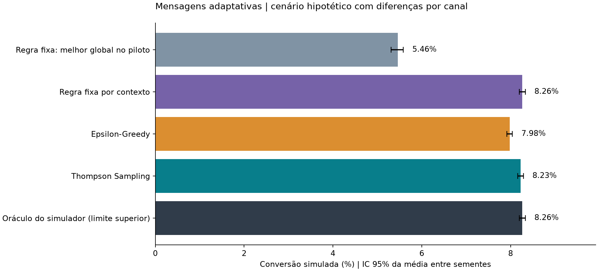
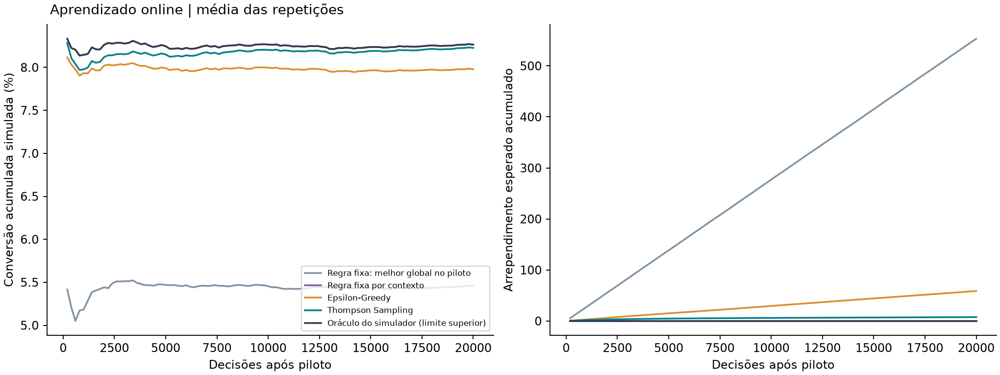

# Datathon MLET | Mensagens adaptativas

Um banco digital quer apresentar uma oferta de depósito a prazo, já aprovada, a clientes elegíveis. A mesma oferta pode ser comunicada de três formas: uma mensagem curta, uma explicação guiada ou um resumo de benefícios. A melhor forma muda conforme o contexto do cliente, e usar uma mensagem única para todos desperdiça conversões. Um teste A/B longo resolve, mas gasta tráfego com as opções piores enquanto roda.

Este projeto usa Thompson Sampling para escolher a mensagem por tipo de contato e aprender com as conversões observadas. O modelo não decide crédito, preço nem elegibilidade: essas condições chegam prontas de fora.

**Resultado:** no cenário principal, o Thompson Sampling converteu 8,23%, contra 5,46% da melhor mensagem única. São 2,77 pontos percentuais a mais, com intervalo de confiança de 95% entre 2,64 e 2,91 p.p., em 30 execuções. A base não registra como os clientes reagiram a cada mensagem, então essas respostas são simuladas (ver [Limitações](#8-limitações)).

## Identificação

| Campo | Valor |
|---|---|
| Turma | 7MLET |
| Grupo | 10 |
| Integrante | Rafael Elias Ferreira Bergsten (rafaeleliasf@gmail.com) |
| Repositório | [rafaelbergsten/datathon-7mlet-grupo-10](https://github.com/rafaelbergsten/datathon-7mlet-grupo-10) |

## 0. Organização e execução

Requer Python 3.12. Rode os comandos na raiz do projeto:

```bash
python3 -m venv .venv
source .venv/bin/activate
python -m pip install -r requirements-lock.txt

python -m banditlab.data         # baixa a base do Kaggle e mantém só as colunas usadas
python -m banditlab.experiment   # roda os experimentos, salva a política e registra no MLflow
python demo.py                   # executa os cinco casos do Golden Set
uvicorn banditlab.api:app --host 127.0.0.1 --port 8000
```

No Windows, ative o ambiente com `.venv\Scripts\Activate.ps1`. O `requirements.txt` fixa as dependências diretas e o `requirements-lock.txt` fixa também as transitivas. Não é preciso chave de API nem conta em nuvem.

Com a API no ar, a interface fica em [http://127.0.0.1:8000/docs](http://127.0.0.1:8000/docs). Em outro terminal:

```bash
mlflow server --backend-store-uri sqlite:///mlflow.db --host 127.0.0.1 --port 5001
jupyter lab notebooks/01_datathon.ipynb
```

O MLflow abre em [http://127.0.0.1:5001](http://127.0.0.1:5001). O notebook já vem executado, e há uma [versão em HTML](notebooks/01_datathon.html) para ler sem Jupyter.

Se o download do Kaggle falhar, baixe o ZIP pela página da base e rode `python -m banditlab.data --archive /caminho/bank-marketing.zip`. O pipeline confere o SHA-256 do arquivo e recusa outra versão.

```text
banditlab/data.py            download, validação e seleção de colunas
banditlab/bandit.py          Thompson Sampling e Epsilon-Greedy
banditlab/experiment.py      piloto, simulação, métricas, gráficos e MLflow
banditlab/service.py         recomendação e feedback com estado em SQLite
banditlab/api.py             API FastAPI
notebooks/01_datathon.ipynb  EDA, experimentos e Golden Set
demo.py                      Golden Set pelo terminal
config.json                  parâmetros e hipóteses do simulador
data/manifest.json           versão, licença e hashes dos dados
models/policy.json           política treinada servida pela API
results/                     tabelas, gráficos e evidências
tests/                       testes do algoritmo, dos dados e da API
```

## 1. Base Kaggle e EDA

Base: [Bank Marketing (henriqueyamahata), Kaggle](https://www.kaggle.com/datasets/henriqueyamahata/bank-marketing), versão 1, arquivo `bank-additional-full.csv`, com 41.188 linhas e 21 colunas. Os dados originais são de Moro, Rita e Cortez (2014), publicados na [UCI](https://archive.ics.uci.edu/dataset/222/bank+marketing) sob licença CC BY 4.0 ([DOI 10.24432/C5K306](https://doi.org/10.24432/C5K306)). O `data/manifest.json` guarda a data do download e os hashes do CSV original e da versão reduzida.

São campanhas de telemarketing de um banco português, de maio de 2008 a novembro de 2010, em ordem cronológica. O alvo `y` indica se o cliente contratou o depósito a prazo.

| Coluna mantida | Tratamento | Uso |
|---|---|---|
| `contact` | aceita `cellular` ou `telephone` | contexto do bandit |
| `month` | categórica | EDA e análise temporal |
| `day_of_week` | categórica | EDA |
| `previous` | contagem, não negativa | EDA |
| `poutcome` | resultado da campanha anterior | EDA |
| `y` → `converted` | `yes=1`, `no=0` | taxa de conversão de referência |

A coluna `duration` foi descartada porque só existe depois da ligação, e usá-la vazaria o resultado. Também ficaram de fora idade, profissão, estado civil, escolaridade, dívidas, empréstimos, indicadores econômicos e identificadores, porque o bandit não precisa deles. Valores ausentes ou rótulos inválidos interrompem o pipeline com erro. Linhas que ficaram iguais depois da redução de colunas foram mantidas, já que representam contatos diferentes.

O notebook mostra contagens, nulos, distribuição do alvo (11,3% de conversão), taxas por tipo de contato e a mudança da base ao longo do tempo.

## 2. Preparação da base

A base tem conversão, mas cada cliente recebeu uma única abordagem, que não é nenhuma das nossas três mensagens. Não há como saber, a partir dela, qual mensagem converteria mais. Por isso usamos a base para calibrar taxas de conversão reais por tipo de contato e simulamos o efeito de cada mensagem sobre essas taxas:

1. **Divisão cronológica.** As primeiras 24.712 linhas (60%) calibram as taxas; as 8.238 seguintes (20%) e as últimas 8.238 (20%) só definem a proporção de tipos de contato no cenário `observed_mix`.
2. **Taxa de referência** por contexto: `(conversões + 1) / (contatos + 2)`, calculada só com os primeiros 60%.
3. **Probabilidade por mensagem:** `taxa de referência × multiplicador`, limitada entre 0,001 e 0,999. Os multiplicadores estão no `config.json` e foram fixados antes de rodar os experimentos.
4. **Piloto:** 3.000 interações com mensagens sorteadas ao acaso. Todas as políticas partem desse mesmo histórico.
5. **Avaliação:** 20.000 interações novas por execução. Cada política só vê o resultado da mensagem que escolheu.

| Contexto | Mensagem curta | Explicação guiada | Resumo de benefícios |
|---|---:|---:|---:|
| `cellular` | 1,55× | 0,60× | 1,00× |
| `telephone` | 0,60× | 1,90× | 1,00× |

Com esses multiplicadores, as taxas simuladas ficam em torno de 9,05%, 3,50% e 5,84% no celular e 2,38%, 7,52% e 3,96% no telefone fixo.

Rodamos três cenários:
- **`contextual`** (principal): metade do tráfego em cada tipo de contato.
- **`observed_mix`**: a proporção real de contatos dos períodos mais recentes da base, cerca de 90% celular.
- **`equal_arms`**: as três mensagens com a mesma taxa. É um controle negativo: nenhum método deveria ganhar aqui.

## 3. Baseline e algoritmo

**Baseline principal:** a mensagem com melhor conversão no piloto, enviada para todos. É a regra "sempre a mesma oferta", escolhida com dados, e não uma mensagem ruim de propósito.

**Baseline por contexto:** a melhor mensagem do piloto para cada tipo de contato, também fixa. Serve para ver se uma regra simples já resolve.

**Thompson Sampling:** cada par contexto/mensagem começa com uma distribuição Beta(1,1). Uma conversão soma 1 em `alpha` e uma não conversão soma 1 em `beta`. A cada decisão, o algoritmo sorteia uma taxa de cada distribuição do contexto e escolhe a maior. A implementação segue o [tutorial de Russo et al.](https://arxiv.org/abs/1707.02038).

**Epsilon-Greedy:** em 10% das decisões escolhe uma mensagem ao acaso; nas demais, a de maior taxa estimada.

Também calculamos um **oráculo**, que conhece as probabilidades do simulador e marca o teto possível.

Não houve ajuste de hiperparâmetros. As 30 execuções usam as sementes de 42 a 71, definidas antes. A política servida pela API é a do Thompson Sampling na semente 42 do cenário principal.

## 4. Avaliação e Golden Set

A métrica principal é a conversão: conversões divididas por decisões. Registramos também o ganho em pontos percentuais, o arrependimento acumulado em relação ao oráculo e quantas vezes cada mensagem foi escolhida em cada contexto. Os intervalos de confiança vêm de bootstrap (5.000 reamostragens) sobre as médias das 30 execuções. Para o ganho, usamos a diferença pareada entre métodos na mesma execução.

| Política | Conversão média (cenário principal) |
|---|---:|
| Melhor mensagem única (baseline) | 5,46% |
| Epsilon-Greedy | 7,98% |
| Thompson Sampling | 8,23% |
| Melhor mensagem por contexto | 8,26% |
| Oráculo | 8,26% |



O Thompson Sampling converte 50,65% a mais que a mensagem única. Ele fica 0,038 p.p. abaixo da regra fixa por contexto (IC 95% entre -0,052 e -0,026 p.p.): neste cenário as taxas não mudam e o piloto já achou a melhor mensagem de cada contexto, então explorar tem um custo pequeno e não traz nada. O bandit foi pensado para quando o comportamento muda, situação que uma regra fixa não acompanha; esse cenário não foi testado aqui.

No cenário `observed_mix`, o Thompson converte 8,77% contra 8,25% da mensagem única, um ganho de 0,522 p.p. (IC 95% entre 0,495 e 0,549). Como quase todo o tráfego é de celular, sobra pouco a ganhar. No controle `equal_arms`, a diferença é de -0,025 p.p. (IC 95% entre -0,093 e 0,045), ou seja, nenhum ganho falso.



**Leitura para o negócio:** segmentar a mensagem por contexto tem potencial claro, e o próximo passo seria um teste controlado com clientes reais. Com o comportamento estável, uma regra fixa por contexto já captura quase todo o ganho. O bandit faz sentido se o banco quiser continuar aprendendo com o tráfego e reagir a mudanças, o que ainda precisa ser testado.

### Golden Set

Cinco clientes fictícios, avaliados contra `models/policy.json` no modo `greedy` (sempre a melhor estimativa, para o resultado ser reproduzível):

| Caso | Cliente | Recomendação | Por que faz sentido |
|---|---|---|---|
| A | `cellular`, elegível, com permissão | `short_message` | melhor mensagem para celular |
| B | `telephone`, elegível, com permissão | `guided_explanation` | melhor mensagem para telefone fixo |
| C | `cellular`, inelegível | nenhuma (`ineligible`) | respeita a elegibilidade |
| D | `telephone`, sem permissão | nenhuma (`no_consent`) | respeita a permissão de contato |
| E | contexto desconhecido | nenhuma (`unknown_context`) | encaminha para análise humana |

`python demo.py` roda os cinco casos e salva o resultado em `results/golden_set.json`. Todos passam.

## 5. API

Em `/docs`, abra `POST /recommend`, clique em **Try it out** e envie:

```json
{"contact": "cellular", "eligible": true, "consent": true, "mode": "sample"}
```

A resposta traz a mensagem escolhida, o identificador da decisão (`decision_id`), o modo e a versão do modelo. O campo `posterior_mean` é a taxa de conversão estimada para aquela mensagem. No modo `sample`, que é o padrão, a API às vezes escolhe outra mensagem para continuar aprendendo; o modo `greedy` sempre devolve a melhor estimativa.

Para registrar o resultado, envie o `decision_id` em `POST /feedback` com `reward` 1 (converteu) ou 0 (não converteu). Só a mensagem daquela decisão é atualizada. Reenviar o mesmo resultado não conta duas vezes, um resultado conflitante retorna 409 e uma decisão inexistente retorna 404. Decisões sem feedback ficam pendentes e não viram zero automaticamente.

`GET /health` confirma que o modelo carregou. `GET /metrics` mostra decisões, conversões, feedback pendente, distribuição de mensagens, número de requisições e latência média.

O estado fica em SQLite, então o aprendizado sobrevive a reinícios. Para publicar uma nova versão do modelo, use um banco novo, e as contagens das versões não se misturam:

```bash
DATATHON_STATE_DB=runtime/demo-v2.sqlite uvicorn banditlab.api:app --host 127.0.0.1 --port 8000
```

Eventos com mais de 30 dias são apagados quando a API inicia, e as contagens do modelo são mantidas. Para limpar manualmente:

```bash
python -c 'from banditlab.service import DecisionService; from banditlab.data import ROOT; print(DecisionService(ROOT / "runtime/decisions.sqlite").purge_old_events())'
```

A API é uma demonstração local: não tem autenticação nem limite de requisições, por isso deve rodar em `127.0.0.1`.

## 6. Arquitetura-alvo na AWS

A API iria para um contêiner no ECR, executado no ECS com Fargate, que [roda contêineres sem gerenciar servidores](https://docs.aws.amazon.com/AmazonECS/latest/developerguide/AWS_Fargate.html), atrás de um Application Load Balancer com TLS e autenticação. Dados, configurações e artefatos do modelo ficariam no S3. O estado das decisões e o backend do MLflow sairiam do SQLite para um PostgreSQL no RDS.

Os eventos de feedback passariam por uma fila SQS, consumida por um serviço autenticado. Treino e avaliação rodariam como tarefas agendadas, e um novo modelo só entraria em produção após revisão humana das métricas. O CloudWatch acompanharia logs, latência, erros, volume de feedback e a distribuição dos contextos; uma queda de conversão ou mudança forte no perfil do tráfego dispararia alerta e, se necessário, a volta para a regra fixa. As permissões seguiriam o IAM com privilégio mínimo e os dados ficariam criptografados. Essa arquitetura é uma proposta: o projeto roda localmente.

## 7. MLOps e governança

O [MLflow](https://mlflow.org/docs/latest/ml/tracking/) guarda cada execução completa como um run pai com 450 runs filhos (3 cenários × 5 políticas × 30 sementes). O run pai registra a configuração, os hashes dos dados e do código, os ganhos com seus intervalos de confiança e a política treinada. Cada filho registra cenário, política, semente e métricas. O arquivo `results/tracking.json` lista os IDs dos runs.

O versionamento combina Git para código e configuração, dependências fixadas, SHA-256 da base e um identificador de versão no `policy.json`.

**Dados pessoais:** o projeto usa só a base pública e clientes fictícios. O pipeline lê apenas as colunas necessárias, e a base bruta não é salva em disco. Numa operação real, o uso de dados de clientes para marketing precisaria de base legal definida pelo banco, conforme a [LGPD](https://www.planalto.gov.br/ccivil_03/_ato2015-2018/2018/lei/l13709.htm); o campo `consent` da API apenas simula essa verificação.

**Decisão humana:** a escolha das mensagens, a elegibilidade dos clientes, a promoção de novos modelos e a resposta a incidentes continuam com pessoas. Casos com contexto desconhecido não recebem recomendação e ficam para análise.

## 8. Limitações

- As respostas às três mensagens são simuladas a partir de multiplicadores definidos por nós. O ganho mostra que o método funciona no simulador, não que ele aumentaria a conversão de um banco real.
- A base é antiga (2008 a 2010), de telemarketing, e `cellular`/`telephone` são tipos de ligação, não canais digitais.
- A única variável de contexto é o tipo de contato; perfis mais detalhados ficaram de fora.
- O cenário é estável. Mudança de comportamento ao longo do tempo, atraso na conversão, fadiga de contato e custo por mensagem não foram testados.
- O modelo nunca descarta dados antigos, então se adaptaria devagar a uma mudança brusca.
- Não há dados de gênero, raça ou renda para avaliar se o modelo trata grupos de forma justa.

## Verificação

```bash
python -m pytest -q
ruff check .
ruff format --check .
python demo.py
```
